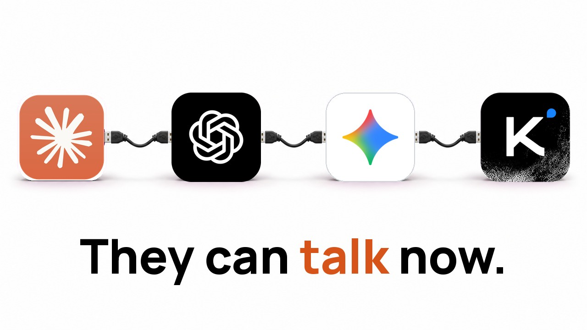
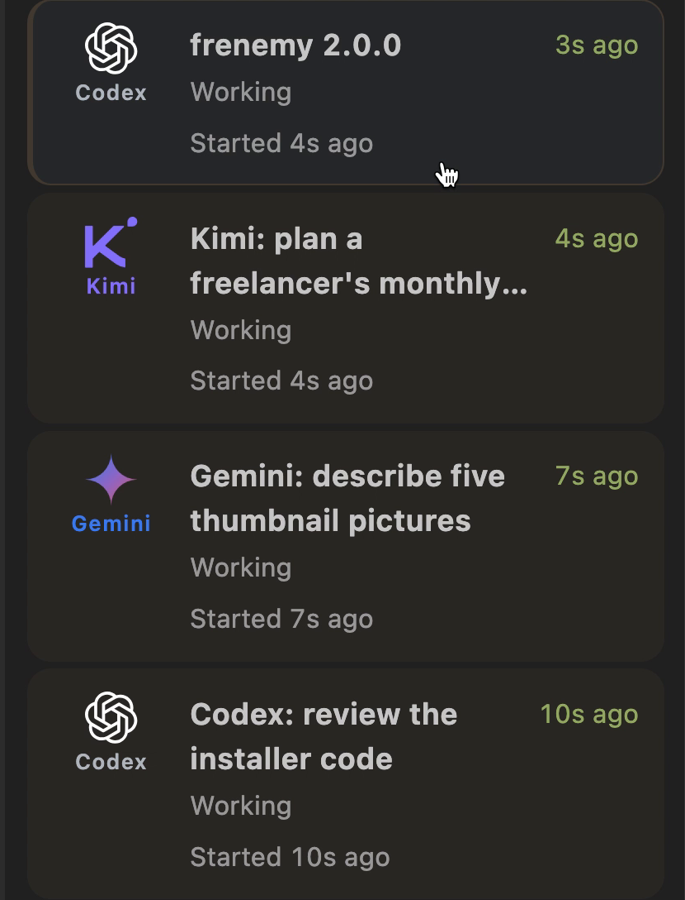

# Frenemy 2: Claude ↔ Codex ↔ Gemini ↔ Kimi



Version 1 let Claude and Codex call each other. Version 2 seats four: Claude Code, Codex,
Gemini (through Google's Antigravity app, `agy`) and Kimi Code. Any of them can lead and
hand work to the others, so you never copy/paste between them.
Runs on the **subscriptions you already pay for**. No API keys.

Created by **Zakariya Syed**:
[YouTube](https://youtube.com/@noblehacksacademy) ·
[LinkedIn](https://www.linkedin.com/in/zakariya-syed/) ·
[X](https://x.com/ZakariyaHacks) ·
[GitHub](https://github.com/noblehacks)

Not affiliated with Anthropic, OpenAI, Google or Moonshot AI. MIT licensed (see LICENSE),
the same as version 1.

**What you need:** Node.js 18 or newer, and at least two of these installed, on your
`PATH` and signed in: Claude Code (`claude`), Codex (`codex`), Antigravity (`agy`), Kimi
Code (`kimi`). You do not need all four; Frenemy connects the ones it finds. VS Code is
needed only for the Snitch panel. No Python, no WSL.

## Install (one command)

Download `Frenemy-2.0.0.zip` from the [latest release](https://github.com/noblehacks/frenemy/releases/latest) (the attached file, not the
"Source code" ones), unpack it, open a terminal inside the folder, and run:

**Mac / Linux:**
```bash
bash install.sh
```

**Windows (PowerShell):**
```powershell
.\install.ps1
```
(If Windows blocks the script: `powershell -ExecutionPolicy Bypass -File install.ps1`)

That one command installs Frenemy, puts the Snitch panel into VS Code and connects every
AI app it finds to the others. It saves a copy of any settings file before changing it, and
it is safe to run again.

Then restart the AI apps you have open and reload VS Code. Codex asks once to trust the new
hooks; say yes. How to undo it, and the options: [INSTALL.md](INSTALL.md).

## How to use it

Type what you want in the app you are using. That app is the driver.

> "Ask Codex to review this file."
> "Get a second opinion from Gemini on this plan."
> "Have Kimi build the settings page in its own copy, then show me what changed."

## What is new in version 2


- **Four AIs instead of two.** Claude, Codex, Gemini and Kimi, each able to ask the other three.
- **Anyone can drive.** The app you are typing in is the driver. It takes your request and
  hands out the work. Each driver gets the other three as tools.
- **Two kinds of jobs.** Advice: one AI asks another for a review, an audit or a second
  opinion. Real work: the driver has another AI build something in its own separate copy,
  and checks it before anything touches your real files.
- **Snitch.** A panel in VS Code that shows which AI is working, which one is driving and
  which one has finished.
- **One command to install**, on Mac, Linux and Windows. Node.js only.

## Snitch: see who is doing what



A real capture of the panel while Claude was driving: Codex, Kimi and Gemini each on a job
at the same time. When a provider refuses an account, or a subscription or quota runs out,
the failed row says so in the provider's own words. Open the panel in VS Code with
**Snitch: Show Jobs**.

Snitch comes with Frenemy 2; the same install command puts it into VS Code. No VS Code on
your computer? The installer says so, skips the panel and installs everything else. To
leave the panel out on purpose, add `--no-snitch` to the install command.

## More detail

- What the installer changes on your computer, and how to undo it: [INSTALL.md](INSTALL.md)
- What was tested, and what was not: [RELEASE-STATUS.md](RELEASE-STATUS.md)
- Real-work jobs: the other AI builds in its own copy and the driver applies it. For those
  jobs Gemini and Kimi run their tools without asking each time, so only hand out work you
  mean to. More: [worker safeguards](notes/WORKER-SAFEGUARDS.md)

## Coming from version 1?

Version 1 is still here, under the [v1.0.0 tag](https://github.com/noblehacks/frenemy/tree/v1.0.0).
To move up, download version 2 into a new folder and run its installer. More in
[INSTALL.md](INSTALL.md).

Free for all to use, under the MIT License, the same as version 1; see LICENSE. Third-party product names and marks belong to their respective owners; inclusion does not imply endorsement. Snitch is not on the VS Code Marketplace; the installer puts it into VS Code directly.
